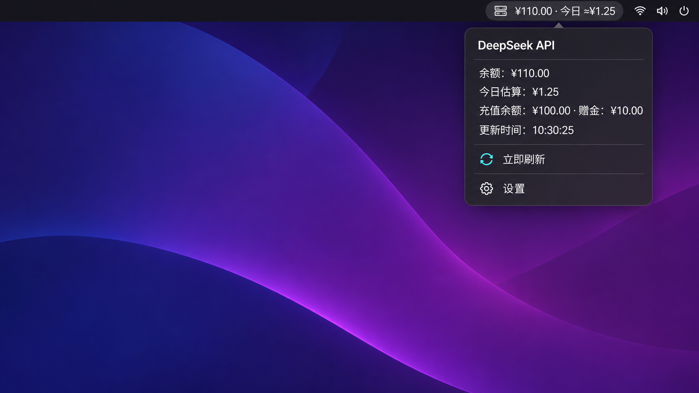

# DeepSeek Usage & Balance for GNOME


[中文](#中文) · [English](#english)



> The preview is a privacy-safe UI mockup with fictional balance data. / 预览图为使用虚构余额数据制作的隐私安全界面效果图。

## 中文

一个 GNOME Shell 扩展，在 Ubuntu/GNOME 顶栏显示 DeepSeek API 余额和当日消费估算。

### 功能

- 通过 DeepSeek 官方余额接口显示总余额、充值余额和赠金余额。
- 根据扩展运行期间观察到的余额下降，估算本地自然日消费。
- 可设置刷新间隔、首选币种和低余额提醒阈值。
- API Key 通过 libsecret 保存在 GNOME Keyring，不写入 GSettings 或源码。
- 提供简体中文和英文界面。
- 支持 GNOME Shell 48、49 和 50。

### 重要说明

DeepSeek 目前提供账户余额接口，但没有每日用量历史接口。因此，“今日消费”是扩展根据余额下降得出的估算值：每天第一次读取余额时从零开始；充值导致的余额增加不会被算作负消费，但赠金到期可能被误认为消费。

### 从源码安装

Ubuntu 通常已经随 GNOME Shell 安装了运行依赖。如有缺失，可执行：

```bash
sudo apt install gnome-shell-extension-prefs gir1.2-secret-1 gir1.2-soup-3.0
```

构建、测试并安装：

```bash
make check
make install
```

首次安装后，请注销并重新登录，让 GNOME Shell 重新扫描用户扩展，然后启用：

```bash
gnome-extensions enable deepseek-usage@yuqingli525.github.com
```

打开“扩展”应用，进入 **DeepSeek Usage & Balance** 设置，填写 DeepSeek API Key。保存后，密钥会进入 GNOME Keyring，顶栏将自动刷新余额。

### 使用

顶栏默认显示：

```text
¥110.00 · 今日 ≈¥1.25
```

点击顶栏项目可查看总余额、今日估算、充值余额、赠金、更新时间，并可手动刷新或打开设置。

### 开发与打包

```bash
npm test
make pack
```

生成的扩展安装包位于 `dist/`。

### 数据与隐私

扩展只会向以下 DeepSeek 官方地址发送带身份验证的 `GET` 请求：

```text
https://api.deepseek.com/user/balance
```

请求不会经过第三方代理；扩展不收集分析数据。请参阅 [DeepSeek 官方余额接口文档](https://api-docs.deepseek.com/zh-cn/api/get-user-balance/)。

---

## English

A GNOME Shell extension that shows your DeepSeek API balance and estimated daily spending in the Ubuntu/GNOME top bar.

### Features

- Shows the current total, topped-up, and granted balances from DeepSeek's official balance API.
- Estimates spending for the current local day from balance decreases observed while the extension is running.
- Configurable refresh interval, preferred currency, and low-balance threshold.
- Stores the API key in GNOME Keyring through libsecret—never in GSettings or source files.
- Simplified Chinese and English UI.
- Native GNOME Shell 48, 49, and 50 support.

### Important limitation

DeepSeek currently exposes the account balance but not a daily usage-history endpoint. The extension therefore estimates today's spending from observed balance decreases. The estimate starts at zero on the first observation of each local day. Top-ups are ignored, but an expiring grant can still look like spending.

### Install from source

Ubuntu normally installs the runtime dependencies with GNOME Shell. If needed, install them with:

```bash
sudo apt install gnome-shell-extension-prefs gir1.2-secret-1 gir1.2-soup-3.0
```

Build, test, and install:

```bash
make check
make install
```

After the first installation, log out and back in so GNOME Shell can discover the new user extension, then enable it:

```bash
gnome-extensions enable deepseek-usage@yuqingli525.github.com
```

Open **Extensions**, select **DeepSeek Usage & Balance**, and paste a DeepSeek API key into the settings window. The key is stored in GNOME Keyring, and the top-bar balance refreshes automatically.

### Usage

The top bar displays a compact summary such as:

```text
¥110.00 · Today ≈¥1.25
```

Click the indicator to see the total balance, today's estimate, topped-up and granted balances, last update time, manual refresh action, and settings shortcut.

### Development and packaging

```bash
npm test
make pack
```

The distributable extension archive is written to `dist/`.

### Data and privacy

The extension sends one authenticated `GET` request to DeepSeek's official endpoint:

```text
https://api.deepseek.com/user/balance
```

Requests are not proxied through another server, and the extension collects no analytics. See the [official DeepSeek balance API documentation](https://api-docs.deepseek.com/api/get-user-balance/).

## License / 许可证

[MIT](LICENSE)
